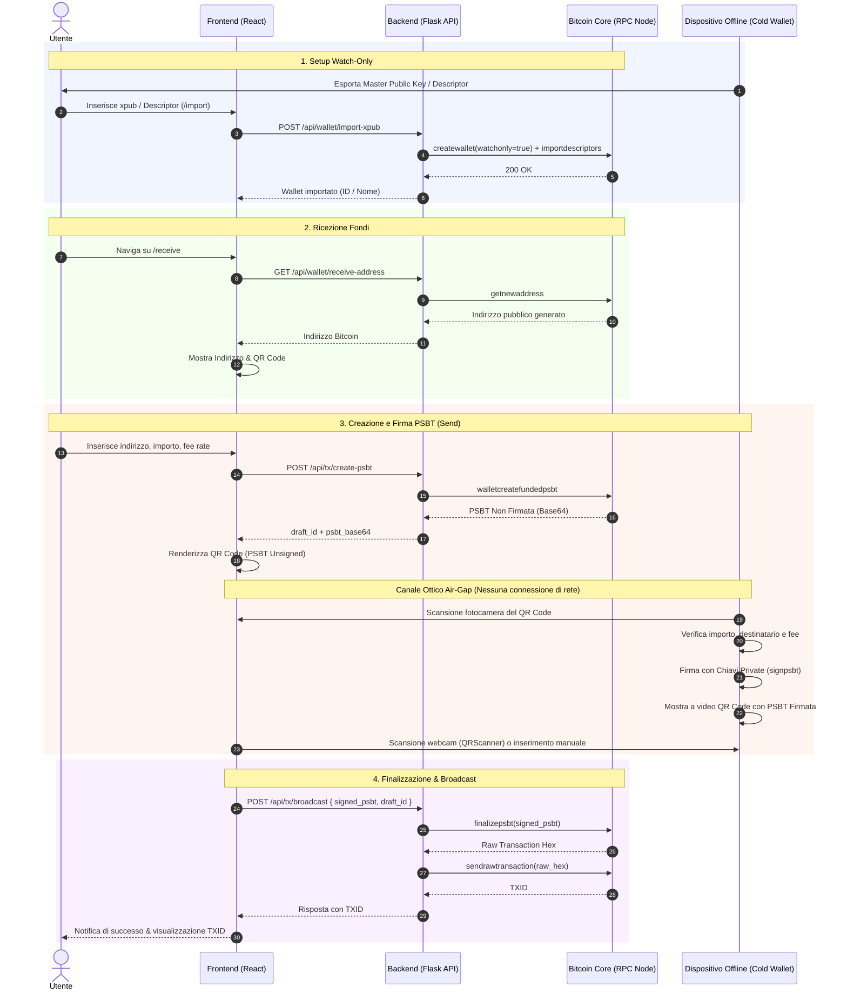
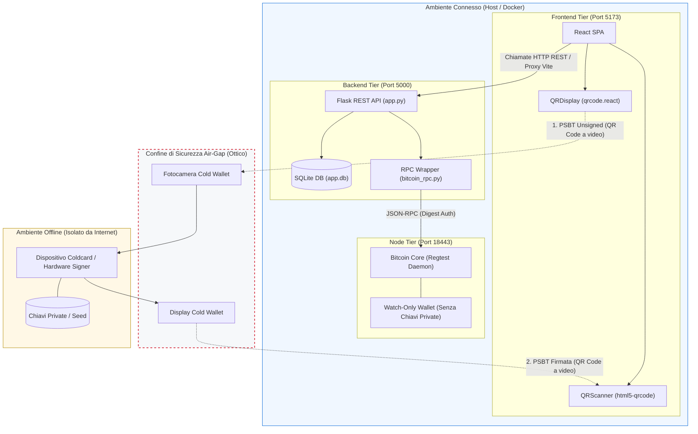

# Coordinatore di transazioni watch-only per cold storage
Implementazione client/server in React e Flask interfacciata via JSON-RPC nativo a Bitcoin Core (standard BIP 32 / BIP 174).

## 1. Obiettivo e Problema Risolto
L'applicazione risolve il problema del coordinamento sicuro dei fondi conservati in dispositivi air-gapped (Cold Wallet). Adottando un'architettura watch-only, il sistema separa la preparazione dei dati (online) dalla firma autorizzativa (offline). Manipola esclusivamente chiavi pubbliche estese (xpub) e transazioni PSBT, garantendo l'impossibilità matematica di esfiltrare chiavi private dal server.

## 2. Architettura e Stack Tecnologico
Il progetto è strutturato su un'architettura a tre livelli, disaccoppiando il livello di persistenza relazionale dal registro distribuito on-chain:
*   **Frontend (React/Vite):** Interfaccia reattiva per il calcolo dei saldi e l'acquisizione delle firme via QR scanner (Air-Gap).
*   **Backend (Python/Flask):** Gateway RESTful e client RPC nativo.
*   **Database (SQLite/SQLAlchemy):** Persistenza off-chain per caching UTXO, tracciamento bozze transazionali e ottimizzazione delle performance.
*   **Blockchain (Bitcoin Core):** Demone isolato in modalità `regtest` per la validazione del consenso e la simulazione locale dei blocchi.

## 3. Istruzioni di Installazione e Avvio
L'intero ambiente è automatizzato e containerizzato per garantire l'esecuzione self-hosted su qualsiasi sistema. 
Assicurarsi di avere Docker e Docker Compose installati, quindi eseguire nella root del progetto:

    docker compose up -d

Il frontend sarà accessibile all'indirizzo http://localhost:3000, mentre il backend e il nodo Bitcoin Core dialogheranno internamente sulla rete virtuale Docker.

## 4. Dichiarazione d'uso di strumenti di Intelligenza Artificiale Generativa
Si dichiara che per la realizzazione del presente progetto software ci si è avvalsi dell'ausilio dei seguenti strumenti di Intelligenza Artificiale Generativa:
*   **Gemini / GitHub Copilot**: utilizzato per la scrittura di codice boilerplate (React UI, script Python), debugging delle chiamate JSON-RPC verso Bitcoin Core e supporto nella stesura dell'infrastruttura Docker Compose.
L'architettura crittografica, la logica di business e il design Zero-Trust basato sugli standard industriali (BIP 174) rimangono interamente frutto dell'elaborazione originale dell'autore. L'autore dichiara di aver effettuato personalmente la verifica funzionale e di sicurezza del codice generato, assumendosi la piena e personale responsabilità del progetto presentato.

## 📁 Struttura del Repository

```text
├── .postman/           # Collezioni e script per il testing delle API REST
├── Server_Flask/       # Backend Python/Flask, modelli DB SQLite e client Bitcoin RPC
├── frontend/           # Interfaccia grafica React/Vite (dashboard, QR scanner e PSBT builder)
├── postman/globals/    # Variabili d'ambiente globali per le chiamate API
├── .gitignore          # Esclusione dipendenze pesanti (node_modules, venv, cache)
├── bitcoin.conf        # Configurazione demone Bitcoin Core in modalità Regtest
├── docker-compose.yml  # Orchestrazione container per esecuzione self-hosted
└── README.md           # Documentazione architetturale e istruzioni di avvio
```
## Architettura del Flusso Dati (Scambio dati Air-Gap)

Di seguito il diagramma di sequenza che illustra l'interazione tra i componenti:


##Diagramma Architetturale dei Componenti (Online vs Offline)
Un diagramma a blocchi per illustrare l'architettura dei confini di rete e sicurezza:

